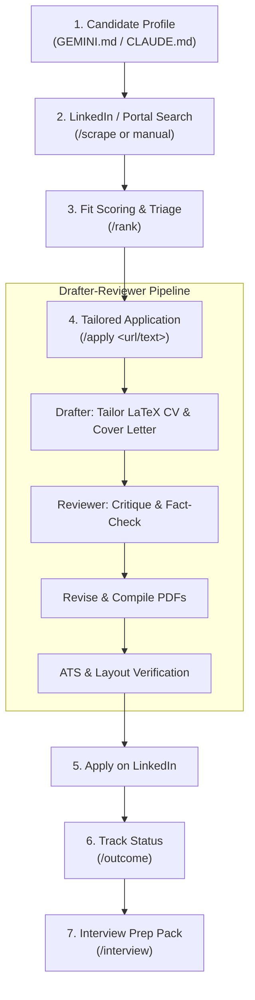

# AI Job Search — How-To Guide & Workflow Manual

Welcome to **AI Job Search**. This framework turns your AI coding assistant (Google Gemini / Antigravity or Claude Code) into a comprehensive career advisor, recruiter-level evaluator, resume tailor, and interview coach that runs entirely on your local machine.

---

## Table of Contents
1. [Overview & Architecture](#1-overview--architecture)
2. [Prerequisites & One-Time Setup](#2-prerequisites--one-time-setup)
3. [The End-to-End Workflow: LinkedIn Example](#3-the-end-to-end-workflow-linkedin-example)
   - [Phase 1: Finding Opportunities on LinkedIn](#phase-1-finding-opportunities-on-linkedin)
   - [Phase 2: Shortlisting & Batch Ranking (`/rank`)](#phase-2-shortlisting--batch-ranking-rank)
   - [Phase 3: Tailoring Applications (`/apply`)](#phase-3-tailoring-applications-apply)
   - [Phase 4: Submitting & Tracking (`/outcome`)](#phase-4-submitting--tracking-outcome)
   - [Phase 5: Interview Preparation (`/interview`)](#phase-5-interview-preparation-interview)
4. [Command Reference Sheet](#4-command-reference-sheet)
5. [Tips & Best Practices for LinkedIn](#5-tips--best-practices-for-linkedin)
6. [Troubleshooting & Verification](#6-troubleshooting--verification)

---

## 1. Overview & Architecture

This application operates using a **thin-pointer architecture** (defined in [`AGENTS.md`](AGENTS.md)):
- **Single Source of Truth**: Your profile, achievements, publications, and skills live in your root agent configuration ([`GEMINI.md`](GEMINI.md) / [`CLAUDE.md`](CLAUDE.md)) and `.claude/skills/job-application-assistant/`.
- **Zero Hallucination Rule**: The assistant is strictly audited never to fabricate skills, experience, or metrics. Every bullet in your tailored CV must map directly to grounded facts in your profile.
- **Two-Agent Drafter-Reviewer Loop**: When applying, one agent drafts your CV and cover letter, while a second reviewer agent independently critiques the drafts, checks for company context, and verifies factual grounding.
- **Strict PDF & ATS Verification**: Documents are compiled to PDF (`lualatex` for 2-page CVs, `xelatex` for 1-page cover letters) and tested with automated ATS text-layer extraction tools.



---

## 2. Prerequisites & One-Time Setup

Before running workflows, ensure your local environment has the required tools installed:

### 2.1. Python Virtual Environment (`.venv`)
The workspace includes Python helper tools for layout verification, ATS text-layer checking, and salary lookup:
```bash
# Activate the existing virtual environment
source .venv/bin/activate    # On Windows: .venv\Scripts\Activate.ps1

# Install requirements (pypdf, pyyaml, openpyxl, pytest)
pip install -r requirements.txt
```

### 2.2. LaTeX Distribution
Required to compile pixel-perfect moderncv CVs and fontspec cover letters:
- **macOS**: MacTeX or BasicTeX (`brew install --cask mactex-no-gui`)
- **Linux**: `sudo apt install texlive-full` (or `texlive-xetex texlive-luatex`)
- **Windows**: [MiKTeX](https://miktex.org/download)

Test your LaTeX compilers:
```bash
which lualatex xelatex
```

### 2.3. Bun (Job Search CLIs)
The portal search tools (including LinkedIn and Freehire) run via TypeScript with [Bun](https://bun.sh):
```bash
# macOS/Linux installation:
curl -fsSL https://bun.sh/install | bash
export PATH="$HOME/.bun/bin:$PATH"

# Install dependencies for all portal CLIs:
python tools/install_portal_clis.py
```
*(Note: `linkedin-search` has zero runtime dependencies and runs immediately with plain `bun` without any external packages).*

### 2.4. Profile Initialization (`/setup`)
Ensure your candidate profile is populated. Inside your assistant session (Antigravity, Gemini CLI, or Claude Code), run:
```text
/setup
```
Choose one of the 3 paths:
- **Path A**: Read from existing documents placed in `documents/` (CV, LinkedIn PDF export, certificates).
- **Path B**: Paste a copy of your existing CV into the chat.
- **Path C**: Complete an interactive questionnaire.

---

## 3. The End-to-End Workflow: LinkedIn Example

Here is how you use this framework day-to-day when looking for jobs on LinkedIn.

### Phase 1: Finding Opportunities on LinkedIn

You have **three flexible ways** to source LinkedIn job listings:

#### Method A: Automated In-Chat Scrape (`/scrape`)
The easiest way is asking your AI assistant directly in the chat:
```text
/scrape
```
or give it a specific query:
```text
/scrape Infrastructure Architect
```
or natural language:
> *"Search LinkedIn for senior infrastructure architect roles in Tokyo posted in the last 14 days."*

**What happens:**
1. The assistant invokes the `linkedin-search` skill (`.agents/skills/linkedin-search/`).
2. It queries LinkedIn's public endpoints for positions matching your profile.
3. It filters out jobs you have already seen in `job_scraper/seen_jobs.json` or tracked in `job_search_tracker.csv`.
4. It performs a **Quick Fit Assessment** (High, Medium, Low match) and displays the results in a tidy table.

#### Method B: Standalone Terminal CLI (`linkedin-search`)
You can run the LinkedIn search CLI directly from your terminal anytime:
```bash
# Search for Infrastructure roles in Tokyo (posted within last 14 days)
bun run .agents/skills/linkedin-search/cli/src/cli.ts search \
  --location "Tokyo, Japan" \
  -q "Infrastructure Architect" \
  --jobage 14 \
  --format table

# Search for Remote / Hybrid Distributed Systems roles
bun run .agents/skills/linkedin-search/cli/src/cli.ts search \
  --location "Remote" \
  -q "Low Latency Systems" \
  --remote remote \
  --jobage 7 \
  --format table

# Fetch full description and requirements for a specific job ID
bun run .agents/skills/linkedin-search/cli/src/cli.ts detail 4123456789 --format plain
```

#### Method C: Manual LinkedIn Browsing
If you browse LinkedIn on your browser or mobile app:
1. Find a job posting you like on LinkedIn (e.g., `https://www.linkedin.com/jobs/view/1234567890/`).
2. Copy the URL or copy the entire job description text.
3. Bring it straight to the assistant in Phase 3.

---

### Phase 2: Shortlisting & Batch Ranking (`/rank`)

When `/scrape` returns multiple new opportunities (or when you have accumulated several postings), run `/rank` to score them before spending time drafting applications:

```text
/rank
```

**What the AI does:**
1. Reads all newly scraped postings from `job_scraper/seen_jobs.json`.
2. Evaluates each posting across **5 core criteria**:
   - **Skills match**: Core technical requirements vs. your verified capabilities.
   - **Experience match**: Seniority level and domain track record.
   - **Language gate**: Checks against your declared languages (e.g. Japanese, English, Indonesian).
   - **Location & Commute**: Proximity to your home base (e.g., Tokyo area vs remote).
   - **Deal-breakers**: Flags any hard constraints.
3. Displays a prioritized leaderboard with clear rationale for each ranking.
4. Allows you to pick a number from the list to launch `/apply` immediately.

---

### Phase 3: Tailoring Applications (`/apply`)

Once you choose a job, trigger the full drafter-reviewer pipeline:

```text
/apply https://www.linkedin.com/jobs/view/1234567890/
```
> [!TIP]
> If LinkedIn's bot prevention or login wall blocks the assistant from reading the URL, simply paste the job description text:
> ```text
> /apply
> Company: Citadel Securities
> Role: Low-Latency Systems Architect
> Location: Tokyo, Japan
> [Paste full job description text here...]
> ```

#### The 7 Steps of `/apply`:

1. **Host & Provenance Verification**: The assistant verifies whether the link is an official job board or company ATS (Greenhouse, Lever, Workday, etc.).
2. **Fit Assessment & Go/No-Go**:
   - The assistant presents an honest fit score, matching strengths, gaps, and optional salary benchmark.
   - It pauses and asks: *"Should I proceed with drafting the CV and cover letter for this role?"*
3. **Drafting (Drafter Agent)**:
   - Tailors `cv/main_<company>_<role>.tex` using the `moderncv` LaTeX template.
   - Drafts `cover_letters/cover_<company>_<role>.tex` using `cover.cls` with custom Lato/Raleway typography.
   - Adheres strictly to the **Zero Hallucination** policy: all claims, metrics, and dates come from your profile.
4. **Peer Review (Reviewer Agent)**:
   - Spawns a separate reviewer agent that audits the drafts for factual accuracy, company research alignment, and natural phrasing.
5. **Revisions**: Drafter updates the `.tex` files incorporating the reviewer's critique.
6. **Mandatory PDF Compilation**:
   - Compiles CV with `lualatex`:
     ```bash
     cd cv && lualatex -interaction=nonstopmode -halt-on-error main_<company>_<role>.tex
     ```
     *Strict Requirement:* The CV must format to **exactly 2 pages** with zero orphaned titles.
   - Compiles Cover Letter with `xelatex`:
     ```bash
     cd cover_letters && xelatex -interaction=nonstopmode -halt-on-error cover_<company>_<role>.tex
     ```
     *Strict Requirement:* The cover letter must format to **exactly 1 page**.
7. **Automated ATS & Layout Verification**:
   - Runs `tools/verify_pdf.py` to extract the PDF text layer and confirm that email, phone, and keywords are machine-readable.
   - Runs `tools/verify_layout.py` to ensure no visual awkwardness or page overflow.

---

### Phase 4: Submitting & Tracking (`/outcome`)

#### Step 4.1: Submit on LinkedIn
Open LinkedIn (or the employer's direct application link found on LinkedIn):
- Upload the compiled `cv/main_<company>_<role>.pdf`.
- Upload the compiled `cover_letters/cover_<company>_<role>.pdf` (if requested).
- Complete any form questions (you can ask the assistant for advice using `/apply`'s application form guidelines).

#### Step 4.2: Record Application in Tracker
Inform the assistant that you applied:
```text
/outcome <company> <role> applied
```
*Example:*
```text
/outcome "Citadel" "Low-Latency Systems Architect" applied
```

**What this updates:**
1. Adds or updates a row in `job_search_tracker.csv`:
   - `date`: Submission date
   - `company`: Company name
   - `role`: Role title
   - `status`: `applied`
   - `cv_file` / `cover_letter_file`: File paths
2. Archives the job posting, exact CV `.tex`, and cover letter into:
   `documents/applications/<company>_<role>/`

#### Step 4.3: Follow-Up Management
If an application hasn't received a response after 10–14 days:
```text
/outcome followup
```
The assistant identifies applications that have gone quiet and drafts a courteous, professional follow-up message tailored to the role.

---

### Phase 5: Interview Preparation (`/interview`)

When a recruiter or hiring manager from LinkedIn contacts you for an interview:

```text
/interview <company> <role>
```
*Example:*
```text
/interview "Citadel" "Low-Latency Systems Architect"
```

**What the assistant generates:**
1. **Company & Market Briefing**: Researches the firm's recent announcements, engineering blogs, trading volumes, or technological stack.
2. **Tailored STAR Stories**: Maps your verified projects and metrics into the Situation-Task-Action-Result structure matching the job requirements.
3. **Technical & Behavioral Q&A**: Generates anticipated questions (e.g. kernel bypass, PTP timing, hardware acceleration) and provides honest bridge answers for any skill gaps.
4. **Interactive Mock Interview**: Offers a real-time roleplay simulation to practice your answers and sharpen your delivery.

---

## 4. Command Reference Sheet

| Command | Purpose | When to Use |
|---------|---------|-------------|
| `/setup` | Onboard profile & preferences | First time setup, or to calibrate profile/queries (`/setup --section search`). |
| `/scrape` | Search portals & LinkedIn | Daily or weekly to discover new openings. |
| `/rank` | Triage & score candidate jobs | When you have a batch of scraped listings to prioritize. |
| `/apply <url\|text>` | Generate tailored CV & cover letter | Whenever you find a job you want to submit an application to. |
| `/outcome <company> <role>` | Log updates, offers, rejections | After submitting an application or receiving interview feedback. |
| `/interview <company> <role>` | Build interview prep & run mock sessions | When an interview or screening call is scheduled. |
| `/upskill` | Identify market skill gaps & study plan | Periodically to see trending requirements you should learn. |
| `/html-report` | Generate offline visual dashboard | To visualize your application funnel, conversion rates, and stats. |
| `/expand` | Enrich profile from online sources | Scans GitHub, scholar publications, or certifications. |
| `/add-portal` | Scaffold a new job portal CLI | When you want to add a regional job board beyond LinkedIn. |
| `/add-template` | Register custom CV/Cover templates | When using a custom LaTeX or Typst template. |
| `/reset` | Clean slate | To clear personal test data or wipe test state. |

---

## 5. Tips & Best Practices for LinkedIn

1. **Prefer Pasting Job Text if URL is Blocked:**
   LinkedIn frequently updates its anti-scraping and authentication walls. If `/apply <linkedin-url>` fails to fetch or redirects to an authentication page, copy and paste the job description text directly into the chat:
   ```text
   /apply
   Here is the job description from LinkedIn:
   [Paste text]
   ```
2. **Find Direct ATS Links on LinkedIn:**
   Many LinkedIn job posts contain an "Apply on company website" button. If clicked, it redirects to Greenhouse, Lever, Workday, or Ashby. Supplying this direct ATS link to `/apply` often yields higher detail (requisition IDs, team names, exact salary bands) than LinkedIn's summary card.
3. **Beware of Expired "Ghost" Postings:**
   LinkedIn often redirects expired job URLs to "similar jobs" without clearly alerting you. The `linkedin-search` CLI checks the `isActive` flag to detect and mark expired postings as `status: expired` in `job_scraper/seen_jobs.json`.
4. **Respect Rate Limits:**
   LinkedIn's public guest endpoints are for personal job searching. Do not run excessive high-frequency scraping loops.

---

## 6. Troubleshooting & Verification

### Issue: LaTeX compilation fails
- **CV compilation error:** Ensure `lualatex` is used (not `pdflatex`). Modern MiKTeX/TeX Live installs often fail under pdflatex due to `fontawesome5` font expansion.
- **Cover letter compilation error:** Ensure `xelatex` is used, as `cover.cls` relies on `fontspec` to load Lato and Raleway fonts in `cover_letters/OpenFonts/`.

### Issue: CV is 3 pages instead of 2
Run the layout verification script:
```bash
.venv/bin/python tools/verify_layout.py cv/main_<company>_<role>.pdf
```
Adjust vertical spacing using LaTeX commands:
- `\needspace{5\baselineskip}` before `\cventry` to prevent orphaned headings.
- `\enlargethispage{2\baselineskip}` to rescue trailing lines.

### Issue: Check ATS Machine-Readability
To inspect the exact text layer an ATS parser will read:
```bash
.venv/bin/python tools/verify_pdf.py cv/main_<company>_<role>.pdf --dump-text extracted_cv.txt
```
Check that:
- Your email and phone number appear as plain readable text.
- Headings and dates parse cleanly without Unicode ligatures or garbled symbols.
